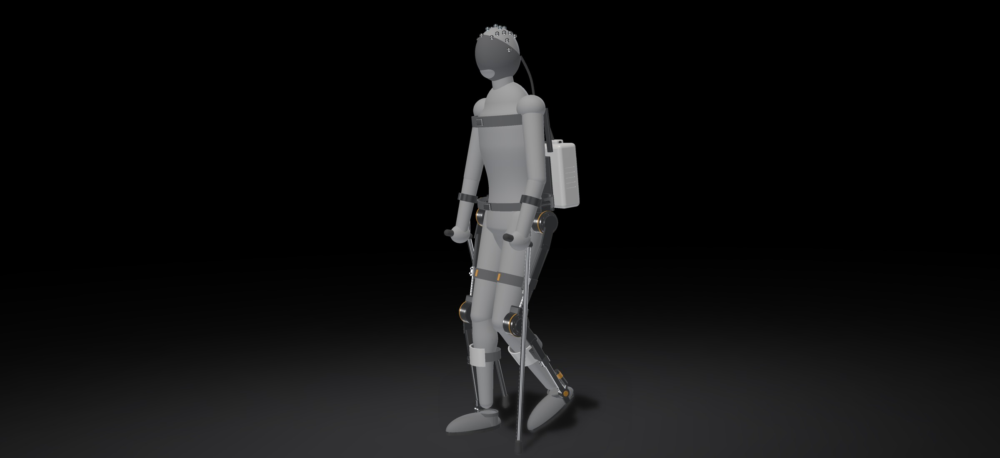

# Volition

A concept design for a brain-controlled lower-limb exoskeleton for people with complete paraplegia. The repository has the parametric CAD model, the electronics and control design, a 1 kHz closed-loop simulation with a synthetic EEG decoder, a rendered film of the simulation and the project website.

Website: https://volition-eight.vercel.app



The film is in [`video/out/Volition_simulation.mp4`](video/out/Volition_simulation.mp4) (44 s, 1080p, 60 fps).

Volition has not been built or tested on people. The dynamics are simplified and the EEG is synthetic, so treat every number here as a design estimate.

## What it does

The user wears a 16-channel EEG cap and walks with two forearm crutches. Imagining a foot movement asks the exoskeleton to move forward through its sequence (sit to stand, then stand to walk). Imagining a hand movement asks it to move back (walk to stop, then stand to sit). A detected intent is only a request: nothing moves until the user presses the confirm button on a crutch handle within 4 s, and the stop button on either crutch works at any time.

In the simulation the user stands up, walks 8 steps (2.66 m at 0.25 m/s), stops and sits down, with every transition triggered by the decoder and confirmed with the button.

## How it works

### Brain-computer interface

After a complete thoracic spinal cord injury, the motor cortex still produces movement commands, but they stop at the lesion. Imagining a movement suppresses the 8 to 13 Hz mu rhythm and the 13 to 30 Hz beta rhythm over the matching area of cortex (event-related desynchronization). Foot imagery shows up around Cz, near the top of the head, and hand imagery over C3 and C4.

The decoder in [`control/bci.py`](control/bci.py) samples 16 channels at 500 Hz (14 over the sensorimotor cortex, 2 for eye movements). Each 1 s window, updated 16 times a second, goes through artifact rejection (clipping, flat lines, step jumps), a 60 Hz notch, an 8 to 30 Hz band-pass, eye-artifact regression and a common average reference. Log band power in the mu and beta bands feeds a shrinkage LDA classifier trained on a simulated calibration session. A leaky evidence integrator with a threshold, a minimum dwell and a refractory period turns the class probabilities into discrete intents.

### Actuators

All four powered joints (both hips and both knees) use the same actuator, the EXA-100: a frameless BLDC motor, a 100:1 strain-wave gear, a crossed-roller output bearing, a strain-gauge torque sensor on the output, a 14-bit motor encoder, a 19-bit absolute output encoder and a spring-applied brake that holds 150 N·m with the power off. It is 100 mm across, 62 mm long and weighs 1.9 kg. The ankles are passive, with a dorsiflexion-assist AFO spring.

### Torque limits and anti-windup

The torque a joint can deliver at any moment is the smallest of five limits, recomputed every millisecond in [`control/actuator.py`](control/actuator.py):

| Limit | Source | Value at the output |
|---|---|---|
| Peak | strain-wave repeated-peak rating of 108 N·m | ±100 N·m |
| Current | 22 A × 0.090 N·m/A × 100 × 0.75 efficiency | ±148 N·m |
| Voltage | dq voltage circle with resistance, inductance and back-EMF at the present speed and bus voltage | falls with speed and battery sag |
| Thermal | lumped winding model, derating from 100 to 120 °C | 45 N·m continuous |
| Slew | gear life and user comfort | 2500 N·m/s |

The joint controller in [`control/joint_controller.py`](control/joint_controller.py) uses a dynamics-model feed-forward plus PID on the output encoder. While a limit binds, the integrator stops accumulating in that direction and is bled toward zero by back-calculation. In a sit-to-stand on a nearly empty battery, this cut the integrator peak from 73 N·m to 16 N·m and the knee overshoot from 1.69° to 0.38°.

### Gait and dynamics

[`control/gait.py`](control/gait.py) plans steps in Cartesian space and converts them to joint angles with two-link inverse kinematics, so the stance foot stays flat on the floor. [`control/dynamics.py`](control/dynamics.py) computes the joint torques with planar Newton-Euler inverse dynamics for the user plus the exoskeleton, with part of the body weight carried by the crutches (25% walking, 30% for sit-to-stand) and by the chair before seat-off.

### Safety

An application processor runs the decoder. A separate lockstep safety controller sends every actuator command and treats the decoder's output as a request. The supervisor in [`control/supervisor.py`](control/supervisor.py) holds posture with the brakes on if tracking error stays over 12°, a torque sensor clips, the bus goes over 58 V or a winding overheats. A bus under 40 V or a lost EEG link ends walking, and a critically low battery sits the user down. A hardwired dual-channel stop chain cuts drive torque and brake power independently of both computers.

## Results from the simulation

85 kg user, 1.80 m tall, exoskeleton mass 19.4 kg.

| Joint and task | Peak torque (N·m) | Peak speed (rad/s) |
|---|---|---|
| Hip, walking | 51.9 | 2.01 |
| Knee, walking | 98.1 | 2.95 |
| Hip, sit to stand | 75.4 | 2.40 |
| Knee, sit to stand | 101.8 | 2.08 |

| BCI (synthetic EEG) | Value |
|---|---|
| Held-out accuracy, 3 classes | 85% |
| Unconfirmed detections in 5 min of rest | 0 |
| Time from imagery onset to detection | 3.3 to 4.7 s |
| EEG windows rejected as artifacts | 7% |

Average power while walking is 55 W, which gives 7.6 h of continuous walking from the 468 Wh pack in the model. That leaves out iron losses, standby electronics and sit-stand cycles, so 3 to 4 h of mixed use is a safer planning figure.

## Open issues

| Issue | What the simulation shows | Proposed fix |
|---|---|---|
| Knee torque at sit-to-stand | 101.8 N·m for an 85 kg user with an extra 15% crutch push, 116 N·m without it, 116 N·m at 100 kg | size-32 gear stage at the knees, or limit users to 90 kg |
| Passive ankle | stance ankle moment peaks at 174 N·m and dorsiflexion reaches about 24°, past the 20° stop | stiffer AFO with an adjustable stop, or powered ankles |
| Standing on a low battery | at 41.6 V open-circuit the bus drops below the 40 V forced-sit threshold during seat-off | refuse to stand below about 44 V open-circuit |
| BCI detection time | 3.3 to 4.7 s from imagery onset to detection | per-user calibration and adaptive thresholds, with button-only control available |
| Trunk lean at sit-to-stand | hip range limits trunk lean to about 34° instead of 38° | extend hip flexion range to 120° |

## Repository layout

| Path | Contents |
|---|---|
| [`params.py`](params.py) | every design parameter: user, structure, actuator, battery, EEG, control and gait |
| [`cad/`](cad/) | CadQuery model; `cad/out/` has the STEP assembly, per-segment STEP files, the actuator STEP and glTF models |
| [`control/`](control/) | gait planner, inverse dynamics, actuator and battery model, joint controller, BCI, supervisor and the closed-loop simulation |
| [`design/`](design/) | actuator sizing, torque-speed envelopes, thermal check and runtime estimate |
| [`sim/out/`](sim/out/) | simulation log (`run.npz`), summary and plots |
| [`video/`](video/) | the renderer and overlay for the film, product renders and the film itself |
| [`docs/`](docs/) | website template and builder |
| [`site/`](site/) | the built website |

## Rebuilding

Python 3.12 with the packages in `requirements.txt`. Every script reads `params.py`, so change a number there and run them in order:

```bash
pip install -r requirements.txt
python cad/build_cad.py
python design/sizing.py
python control/simulate.py
python video/stills.py
python video/render.py --fps 60 --workers 6
python docs/build_page.py
```

The full simulation takes about 15 s. The film takes about 12 minutes on a 10-core laptop.

## Standards and regulation

In the US, powered lower-extremity exoskeletons are Class II devices under 21 CFR 890.3480 (product code PHL). The design would need to meet IEC 60601-1, IEC 80601-2-26 for the EEG equipment, ISO 13482, ISO 14971, IEC 62304 for the software, ISO 13849-1 for the stop chain, and IEC 62133-2 and UN 38.3 for the battery.
